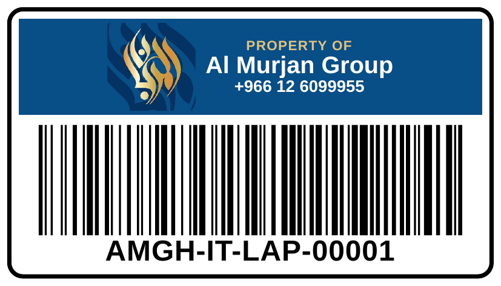
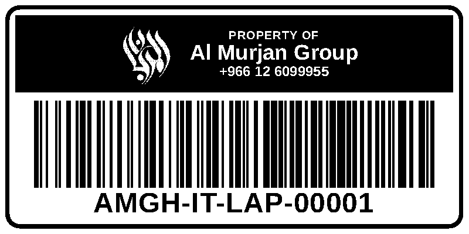

# Asset Tags, QR Labels and Assignments (Phase 5)

## Assigning an asset to a person

1. **Open Assign.** Open the asset (it must be *In stock* or *Reserved*) and click **Assign**.
2. **Find the person.** Type part of the name or employee number in **Find the person**; the list filters as you type. Missing people are added under **Master data > Employees**.
3. **Choose the type:**
   - *Permanent*: issued until the person leaves or returns it.
   - *Temporary* or *Loan*: needs a return-by date.
4. **Optional details.** Record the condition (e.g. "New") and any notes, then click **Assign**. The department defaults to the person's department, and the status becomes *Assigned*.
5. **Hand-over form.** On the **Assignments** tab, click **Hand-over form** and print two copies. The person signs to accept the Acceptable Use terms.
6. **Acknowledgement.** Click **Mark acknowledged**, then attach the signed scan under **Documents** (type *Hand-over form*). Until then the assignment shows *Awaiting signature*.

**Return:** click **Return** on the asset, record the condition, and choose what happens next: *In stock*, *Under maintenance* or *Retired*. Wipe devices that held data before reissuing them (IT Operations SOP).

**Rules enforced by the database:**
- An asset has one custodian at a time.
- Terminated employees cannot receive assets, and an employee cannot be marked terminated while still holding assets.
- Every assignment and return is kept in the asset's history.

**Shared equipment** (meeting-room screens, printers) can be assigned to a department without a person.

## Asset tags (barcode)

**Generate asset tags** produces the classic company property tag:

- a rounded black frame;
- a band with the AMGH emblem, **PROPERTY OF / Al Murjan Group / +966 12 6099955**;
- a Code 128 barcode of the asset number;
- the asset number in large type.

Any USB or Bluetooth barcode scanner reads the barcode and "types" the asset number, for example into the asset search box.



**How to generate tags**

- **Many assets:** in **Assets**, tick the rows and click **Generate asset tags**.
- **One asset:** open it and click **Asset tag**.

**Choose a style**

| Style | Printer | Look |
|---|---|---|
| **Colour** | Colour label printer, or a print shop for pre-printed labels | AMGH blue band, gold emblem, as in the sample |
| **Black & white** | Thermal label printers (Zebra, Brother QL/TD, TSC): these print black only | Solid black band with the calligraphy in white (no grey, which thermal printers cannot print cleanly) |



**Which size scans reliably** (tested by decoding rendered print output):

| Tag size | 300 dpi printer | 203 dpi printer |
|---|---|---|
| 50 × 30 mm | ✓ | ✗ too small for a 17-character barcode; use 70 × 40 |
| 70 × 40 mm | ✓ | ✓ |
| 100 × 50 mm | ✓ | ✓ |

**Settings**

- **Band text:** edit `appsettings.Production.json` to change it:
  ```json
  { "Tags": { "PropertyOf": "PROPERTY OF", "CompanyName": "Al Murjan Group", "ContactLine": "+966 12 6099955" } }
  ```
- **Logo:** to use a different logo, replace `wwwroot/images/amgh-emblem.png` (colour) and `amgh-emblem-mono.png` (white on transparent).
- **Print dialog:** enable **Background graphics** for the colour band to print.

**Reprints:** tag reprints follow the same rules as QR labels (permission and reason). The asset's **Labels** tab shows the design of each print. Printing the first tag for an asset that already has a QR label is not a reprint.

## Printing QR labels

**One asset:** open it and click **Print label**.
**Many assets:** in **Assets**, tick the rows (or the box in the header for the whole page) and click **Print labels for selected**. You can print up to 200 per batch.

Then choose the size and number of copies:

| Size | Use for | QR content |
|---|---|---|
| 50 × 30 mm | phones, docks, peripherals | number, link, name, serial (kept compact so it prints sharply) |
| 70 × 40 mm | laptops, desktops | number, link, name, serial, user, department, location, hostname, status |
| 100 × 50 mm | servers, racks, CCTV recorders | all of the above, plus department/location printed as text and a "return to IT" line |

Clicking **Create label sheet** opens a print page and the print dialog. Each label is one page of exactly the chosen size.

- **QR link:** the link inside every QR code (`https://<server>/a/AMGH-IT-LAP-00001`) opens the **live** record after sign-in, so a scanned label always shows current information even if it was printed before a reassignment. Without signing in, the link only shows the sign-in page.
- **Reprints:** printing again for an asset that already has a label needs the **Reprint QR labels** permission and a reason. Both are recorded on the asset's **Labels** tab, with size, copies, QR version, user and time.
- **QR versions:** when details encoded in the QR change (custodian, location, status…), the next print automatically creates a new QR version, and the previous one is kept as history.

### Label printer set-up (once per printer)

- **Driver:** install the printer's Windows driver (Zebra, Brother, Dymo, TSC, etc.).
- **Paper size:** in the driver's *Printing preferences*, create the paper sizes 50 × 30, 70 × 40 and/or 100 × 50 mm if they are not listed. Use die-cut labels of the same size.
- **Print dialog (Chrome/Edge):** choose the label printer and the matching paper size. Under *More settings*, set **Margins: None**, **Scale: 100** and **Headers and footers: off**. The browser remembers these settings.
- **Resolution:** 300 dpi printers give the sharpest QR codes; 203 dpi works for 70 × 40 and 100 × 50.
- **Labels:** use durable polyester labels for equipment that is handled often.

### Setting

If users reach the site by a different name than the server name (e.g. `https://itinventory.amgh.local`), set it in `appsettings.Production.json` so QR links use it:

```json
{ "Labels": { "BaseUrl": "https://itinventory.amgh.local" } }
```

## ISO/IEC 27001:2022

- **A.5.9 Inventory of assets:** every asset carries a unique, permanent, machine-readable identifier. Labels make physical audits quick (scan to verify).
- **A.5.10 Acceptable use / A.5.11 Return of assets:** signed hand-over acknowledgement, and recorded returns with condition.
- **A.5.12/A.5.13 Labelling:** label print history with reasons for reprints.
