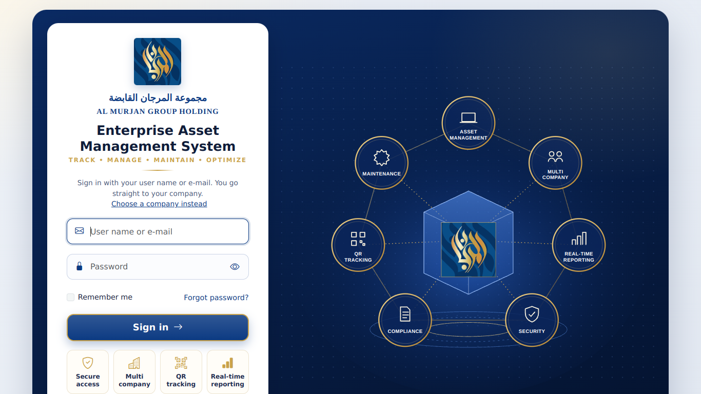

# Release 2.12: new sign-in page

Includes Releases **2.10** (technician assignment) and **2.11** (direct sign-in), and all Release 2.9 fixes. Deploy this release instead of 2.10 or 2.11 if you haven't deployed them yet.



## Deploy (about 10 minutes)

1. **Prepare the files.** Extract `AMGH.ITInventory-Release2.12.zip` to `C:\AMGH\Release2.12\`, unblock the files, and copy `Migrations` from the folder of the release you deployed last (e.g. 2.9):
   ```powershell
   Get-ChildItem C:\AMGH\Release2.12 -Recurse | Unblock-File
   Copy-Item -Recurse -Force C:\AMGH\Release2.9\AMGH.ITInventory\src\AMGH.ITInventory.Persistence\Migrations `
             C:\AMGH\Release2.12\AMGH.ITInventory\src\AMGH.ITInventory.Persistence\
   ```
2. **Build:** `cd C:\AMGH\Release2.12\AMGH.ITInventory; dotnet build AMGH.ITInventory.sln`
3. **Stop the application:** `Import-Module WebAdministration; Stop-WebAppPool -Name AMGHITInventory`
4. **Update the database.** This is script 17 from Release 2.10; 2.11 and 2.12 change nothing in the database. Run it from the **2.12** folder:
   ```powershell
   cd C:\AMGH\Release2.12\AMGH.ITInventory\deployment\PowerShell
   .\Deploy-Database.ps1 -ServerInstance "localhost" -AppLogin "IIS APPPOOL\AMGHITInventory" -AdminEmail "it.admin@amgh.local" -TrustServerCertificate -SkipSeed
   ```
5. **Record the change for EF Core** (skip if you already did it for 2.10): `.\New-BaselineMigration.ps1 -Name AddTechnicianAssignment`
6. **Deploy and start the application:** `.\Deploy-WebApp.ps1`

## What's new

### The page

- **Left card:** the logo, the Arabic and English names, *Enterprise Asset Management System* with the tagline, the sign-in form, and four highlights (secure access, multi company, QR tracking, real-time reporting).
- **Right side:** an illustration of the system's capabilities around the group emblem. It is drawn as a vector, so it stays sharp on any screen, and it is hidden on phones and narrow windows.
- **Company pages** (e.g. `/w/ABC`): the company's own name, its Arabic name (company profile), its logo, and its brand colour on the Sign in button. A company without an uploaded logo shows the group emblem.
- **Same frame elsewhere:** the company picker, the error pages and "Forgot password" use the same design.
- **Dark theme:** supported.

### Signing in

- **User name or e-mail:** either works. E-mail addresses are unique per person, and user names cannot contain "@", so there is never ambiguity.
- **Show password:** the eye button shows or hides what you typed. The password is always hidden again when the form is sent.
- **Remember me:** remembers your **user name** on that computer for 90 days, so next time you only type the password. It does **not** keep you signed in; you are still signed out after inactivity, as your security policy requires. Untick it to forget the name. The name is stored in a protected cookie (HttpOnly, Secure, SameSite=Strict); no password is ever stored.
- **Forgot password?:** explains how to get a reset (your IT department resets it under *Administration → Users and roles*), with the company's contact e-mail and phone from its profile where set.

### Differences from the mockup, on purpose

| Mockup | Release 2.12 | Why |
| --- | --- | --- |
| "OR" above the four tiles | Tiles kept as highlights, without "OR" | "OR" suggests other ways to sign in, which don't exist |
| "Remember Me" | Remembers the user name, not the session | Staying signed in would bypass the inactivity sign-out |
| "Secure • Track • Manage" | "Track • Manage • Maintain • Optimize" | The tagline chosen in Release 2.8; say if you prefer the mockup's |
| Photo background | Vector illustration with the real emblem | Sharp on every screen; no photo licence needed |

## Not in this release

- **Self-service password reset by e-mail** (a time-limited link sent to the person's e-mail). This is now possible, since e-mail sending exists (Release 2.5), and can be a next step.

## Verified

- **Real browser** (headless Chromium):
  - screenshots at desktop (1366×768) and phone size, a company-branded page (ABC with its own colour), the dark theme, the company picker and "Forgot password";
  - 13 interactive checks: focus, show/hide password, Remember me (user name only, protected cookie, filled in next time, focus on the password, forgotten when unticked), e-mail sign-in, wrong password, and the Forgot password link.
- **Security tests:** 112 pass (4 new for e-mail sign-in: success, wrong password and unknown e-mail give the same generic answer, user name still works).
- **Application tests:** 246 pass. The web project builds under the product's strict rules (Debug and Release).
